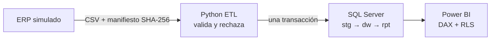

# AgroExport Analytics

Canalización de datos para una agroexportadora **ficticia** con dos sociedades: de las entregas del ERP a un almacén en SQL Server y un reporte en Power BI. Los números de ventas, lotes, embarques y cartera quedan **conciliados y trazables**.



## Qué demuestra

| Capacidad | Dónde |
|---|---|
| **Modelado dimensional**: 4 dimensiones, 4 hechos con granularidad explícita, claves por sociedad, fotografías semiaditivas | [diseno.md](docs/diseno.md), [sql/install](sql/install) |
| **ETL en Python**: manifiesto con huellas, validación por fila, rechazos con motivo, duplicados | [agroexport/](agroexport) |
| **Recuperación ante fallos**: publicación en una transacción, ROLLBACK y bitácora en una conexión aparte | [pipeline.py](agroexport/pipeline.py) |
| **Idempotencia y concurrencia**: huella de paquete, índice único filtrado, `sp_getapplock`, prueba con dos hilos | [tests/](tests) |
| **Conciliación**: filas e importes por dos caminos; la carga se revierte si no cuadran | [06_publish.sql](sql/install/06_publish.sql) |
| **Cargas incrementales**: anulaciones tardías, cambios en datos maestros, cortes nuevos sin tocar el historial | entrega `2026-11-07` |
| **T-SQL analítico**: CTE, `LAG`, `DENSE_RANK`, `SUM() OVER`, agregación condicional | [01_business_questions.sql](sql/analysis/01_business_questions.sql) |
| **Rendimiento**: índice de cobertura medido con `STATISTICS IO` y Query Store (−95 % de lecturas) | [rendimiento.md](docs/rendimiento.md) |
| **Power BI**: Power Query parametrizado, medidas DAX semiaditivas, comparación interanual, RLS por sociedad | [powerbi/](powerbi), [power_bi.md](docs/power_bi.md) |

## Inicio rápido (Windows)

Requisitos: Python 3.11 o superior, SQL Server (Express sirve) con autenticación de Windows y [ODBC Driver 18 for SQL Server](https://learn.microsoft.com/sql/connect/odbc/download-odbc-driver-for-sql-server).

```powershell
git clone https://github.com/Joseph5712/agroexport-analytics.git
cd agroexport-analytics
py -m venv .venv
.\.venv\Scripts\Activate.ps1
pip install -r requirements.txt

# El mismo servidor que usas en VS Code o SSMS, p. ej. 'localhost' o '.\SQLEXPRESS'
$env:AGROEXPORT_SERVER = 'localhost'
python -m agroexport demo
```

`demo` recrea la base `AgroExport` desde cero y recorre el ciclo completo:

```
3. Carga inicial con un fallo simulado (no debe quedar nada publicado)
  Fallo simulado después de publicar y antes de confirmar.
4. Reintento de la carga inicial
  Carga 2: Succeeded
    leídas 31,768 · rechazadas 8 · duplicadas descartadas 1
5. La misma entrega otra vez (debe saltarse)
  Carga 3: Skipped
6. Entrega incremental
  Carga 4: Succeeded
    leídas 1,740 · rechazadas 1 · duplicadas descartadas 0
```

### Comandos

| Comando | Qué hace |
|---|---|
| `python -m agroexport instalar [--recrear]` | Crea la base y ejecuta `sql/install` en orden |
| `python -m agroexport generar [--escala N]` | Genera las dos entregas en `data/entregas` (deterministas) |
| `python -m agroexport cargar CARPETA [--simular-fallo]` | Carga una entrega |
| `python -m agroexport estado` | Muestra las últimas cargas |

Los scripts de `sql/` también se pueden ejecutar a mano en VS Code o SSMS: primero `sql/install/00_create_database.sql`, después el resto en orden de número, conectado a `AgroExport`.

### Configuración

Por variables de entorno, sin secretos en el repositorio: `AGROEXPORT_SERVER`, `AGROEXPORT_DATABASE` (por defecto `AgroExport`) y, solo si no usas autenticación de Windows, `AGROEXPORT_USER` y `AGROEXPORT_PASSWORD`. Ver [db.py](agroexport/db.py).

### Pruebas

```powershell
python -m pytest                              # sin base de datos
$env:AGROEXPORT_RUN_DB_TESTS = '1'
python -m pytest                              # + integración contra SQL Server (usa la base AgroExport_Test)
```

10 pruebas: determinismo del generador, detección de archivos alterados, rechazos exactos, ROLLBACK ante fallo, conciliación contra un cálculo independiente en Python, idempotencia, dos cargas simultáneas y correcciones incrementales. GitHub Actions las ejecuta en cada push contra un SQL Server 2025 en contenedor.

## Datos

El generador crea casi dos años de operación (enero de 2025 a noviembre de 2026): 2 sociedades, 15 clientes en 12 países, 9 productos frescos y procesados, unas 9,400 líneas de venta, notas de crédito, 5,400 embarques y fotografías mensuales de lotes y cartera.

**Errores sembrados a propósito**: cliente inexistente, cantidad cero, fecha imposible, tipo de documento desconocido, duplicado idéntico, clave repetida con datos distintos, kg negativos, embarque despachado sin fecha y producto inexistente. Todos terminan en `dq.RejectedRow` con su motivo.

Todos los datos, clientes y sociedades son ficticios.

## Estructura

```
agroexport/            Python: generador, contrato de archivos, validación, carga y CLI
sql/install/           Esquemas, tablas, procedimientos de publicación y calidad, vistas rpt
sql/analysis/          Preguntas de negocio y prueba de rendimiento
powerbi/               Power Query (M), medidas DAX y roles RLS
tests/                 Pruebas unitarias y de integración con SQL Server
docs/                  Diseño, guía de Power BI, rendimiento, ampliaciones y entrevista
```

## Estado

| Componente | Estado |
|---|---|
| SQL Server + T-SQL | ✅ Implementado y probado en SQL Server 2025 |
| Python ETL | ✅ Implementado y probado |
| Power BI | 🛠️ Medidas, RLS y guía listas; el `.pbip` se construye siguiendo [power_bi.md](docs/power_bi.md) |
| SAP Business One / HANA, Microsoft Fabric, Power Platform | 📄 Diseño documentado en [ampliaciones.md](docs/ampliaciones.md), no implementado |

## Documentación

- [Diseño](docs/diseno.md): problema, arquitectura, granularidad, indicadores, decisiones y límites
- [Guía de Power BI](docs/power_bi.md): paso a paso con valores esperados para conciliar
- [Rendimiento](docs/rendimiento.md): medición antes y después del índice
- [Ampliaciones](docs/ampliaciones.md): SAP, Fabric y Power Platform
- [Guía de entrevista](docs/entrevista.md): demo de 5 minutos y preguntas probables
