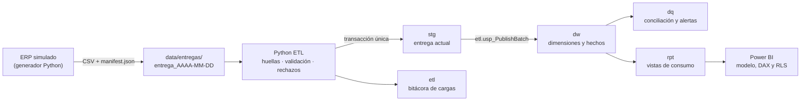
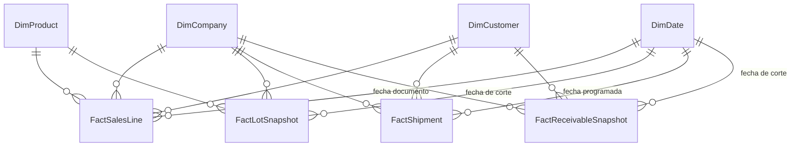

# Diseño

## Problema de negocio

AgroExport Demo es una agroexportadora **ficticia** con dos sociedades (Costa Rica y Guatemala). Vende producto fresco y procesado a clientes de Norteamérica, Europa y Asia. Hoy cada área responde con su propia hoja de cálculo y los números no coinciden.

| Área | Pregunta | Respuesta en el proyecto |
|---|---|---|
| Gerencia | ¿Cómo cambian ventas y margen por sociedad y categoría? | Ventas netas y margen contra el mismo periodo del año anterior |
| Comercial | ¿Qué productos y clientes explican la variación? | Ranking de productos, ventas por cliente y peso de las notas de crédito |
| Planta | ¿Qué lotes están por vencer? | Existencia por lote en la última fotografía y tramos de vencimiento |
| Logística | ¿Qué embarques salieron tarde o siguen pendientes? | Puntualidad por mes y pendientes con fecha vencida |
| Cobros | ¿Qué saldo está vencido y desde cuándo? | Antigüedad de cartera al corte |
| Ingeniería | ¿De dónde salió cada número y se puede confiar en él? | Bitácora de cargas, huellas, rechazos y conciliación |

## Arquitectura

| Pieza | Responsabilidad | Por qué ahí |
|---|---|---|
| Python | Verificar huellas, validar tipos y reglas, separar rechazos, orquestar la transacción | Es más fácil probar reglas en Python (pytest) y dar mensajes claros por fila |
| T-SQL | Traducir códigos a claves, upsert de dimensiones y hechos, conciliación | Las operaciones por conjuntos son más rápidas en el motor y quedan dentro de la transacción |
| Vistas `rpt` | Reglas de presentación (excluir anulados, tramos, atrasos) | Una sola definición para Power BI y para SQL; el reporte no depende de tablas internas |
| Power BI | Medidas que dependen del filtro del usuario y seguridad por sociedad | Es lo único que no se puede precalcular |

## Modelo dimensional

### Granularidad: qué representa una fila

| Tabla | Una fila es | Clave de negocio | Tipo de hecho |
|---|---|---|---|
| `DimCompany` | Una sociedad | `CompanyCode` | — |
| `DimCustomer` | Un cliente **dentro de una sociedad** | `CompanyKey + CustomerCode` | — |
| `DimProduct` | Un artículo dentro de una sociedad | `CompanyKey + ProductCode` | — |
| `DimDate` | Un día del calendario | `DateKey` (AAAAMMDD) | — |
| `FactSalesLine` | Una línea de factura o nota de crédito | `CompanyKey + DocType + DocNumber + LineNumber` | Transaccional (aditivo) |
| `FactLotSnapshot` | Un lote en una fecha de corte | `SnapshotDateKey + CompanyKey + LotCode` | Fotografía (semiaditivo) |
| `FactShipment` | Un embarque en su último estado | `CompanyKey + ShipmentNumber` | Acumulativo (se actualiza) |
| `FactReceivableSnapshot` | Un documento con saldo abierto en una fecha de corte | `SnapshotDateKey + CompanyKey + DocNumber` | Fotografía (semiaditivo) |

El código `C001` existe en las dos sociedades y son clientes distintos, igual que el producto `PIN-001`. Por eso la sociedad forma parte de todas las claves de negocio.

## Indicadores

| Indicador | Definición | Lo que NO es |
|---|---|---|
| Ventas netas USD | Σ(cantidad × precio × tipo de cambio del día), redondeado a centavos **por línea**. Notas de crédito con signo negativo; anulados excluidos. | No incluye impuestos ni fletes |
| Margen comercial | Ventas netas − costo de la línea informado por el ERP | No es utilidad neta: no descuenta flete ni gastos indirectos |
| Variación interanual | Contra el mismo periodo del año anterior (calendario completo) | — |
| Inventario kg al corte | Existencia de la última fotografía que no supere la fecha consultada | No es suma de fotografías |
| Puntualidad de despacho | Despachados en o antes de la fecha programada ÷ despachados | **No es OTIF**: faltan cantidad comprometida y fecha de entrega en destino |
| Cartera vencida | Saldo abierto en el corte con vencimiento anterior a la fecha de corte | — |

## Decisiones y alternativas

| Decisión | Alternativa considerada | Motivo |
|---|---|---|
| Staging tipado y llenado por Python | Staging todo texto y conversión en SQL | Python ya validó los tipos y da el motivo exacto por fila; así se evita convertir dos veces |
| Una transacción para toda la publicación | Una transacción por tabla | Si fallan los embarques, las ventas tampoco deben quedar publicadas: el reporte nunca ve una carga a medias |
| Bitácora en una conexión aparte (autocommit) | Misma conexión | El ROLLBACK borraría también el registro del fallo |
| `UPDATE` + `INSERT` | `MERGE` | Más legible y sin los problemas conocidos de `MERGE` con concurrencia |
| Reemplazar el corte completo en las fotografías | Upsert fila por fila | Si un lote desaparece en la corrección de un corte, un upsert dejaría la fila vieja |
| SCD tipo 1 en dimensiones | SCD tipo 2 (historial de atributos) | Al negocio le basta el nombre actual. El tipo 2 queda como ampliación |
| `sp_getapplock` exclusivo durante la publicación | Confiar en que nadie ejecute dos cargas | Dos cargas simultáneas podrían intercalarse en staging. Se prueba con dos hilos en `tests/` |
| Índice único filtrado `Status = 'Succeeded'` | Solo la comprobación en Python | La base garantiza la idempotencia aunque falle el código |
| Importes `DECIMAL(18,2)` | `FLOAT` | `FLOAT` no representa centavos exactos y la conciliación fallaría por diferencias mínimas |
| Vistas `rpt` como única entrada de Power BI | Power BI leyendo tablas `dw` | El reporte no se rompe si cambia el almacén, y las reglas se definen una sola vez |

## Manejo de situaciones

| Situación | Comportamiento | Dónde se prueba |
|---|---|---|
| El mismo paquete otra vez | `Skipped`, sin cambios | `test_same_package_twice_is_skipped` |
| Dos cargas simultáneas del mismo paquete | Una `Succeeded`, otra `Skipped` | `test_concurrent_loads_publish_once` |
| Duplicado idéntico dentro de un archivo | Se conserva una copia y se cuenta en `RowsDuplicated` | `test_initial_delivery_rejects...` |
| Misma clave con datos distintos dentro de un archivo | Se rechazan todas las versiones | ídem |
| Referencia inválida, tipo o regla incumplida | Fila a `dq.RejectedRow` con motivo y contenido original | ídem |
| Fallo a mitad de la publicación | ROLLBACK completo y lote `Failed` | `test_failure_rolls_back_everything` |
| Conciliación que no cuadra | Error 50002, ROLLBACK y `Failed` | `etl.usp_PublishBatch`, paso 5 |
| Archivo alterado después del manifiesto | No se carga | `test_manifest_detects_tampering` |
| Anulación o corrección de un documento ya cargado | Llega con la misma clave y reemplaza la fila | `test_incremental_applies_corrections...` |
| Corte nuevo de inventario o cartera | Se agrega sin tocar los cortes anteriores | ídem |

## Límites conocidos

- Los datos son sintéticos. El inventario por lote no se descuenta con las ventas: cada fotografía se genera con su propia curva de consumo.
- Una línea de venta referencia un solo lote. Repartir una línea entre varios lotes requiere una tabla puente.
- Un proceso que muere por completo (se corta la luz) deja el lote en `Running`. La siguiente carga funciona igual, pero esa fila hay que revisarla y marcarla a mano.
- Las cargas son por entregas completas de una ventana. Para cargas incrementales directas desde un ERP haría falta un *watermark* que avance solo después del COMMIT.
